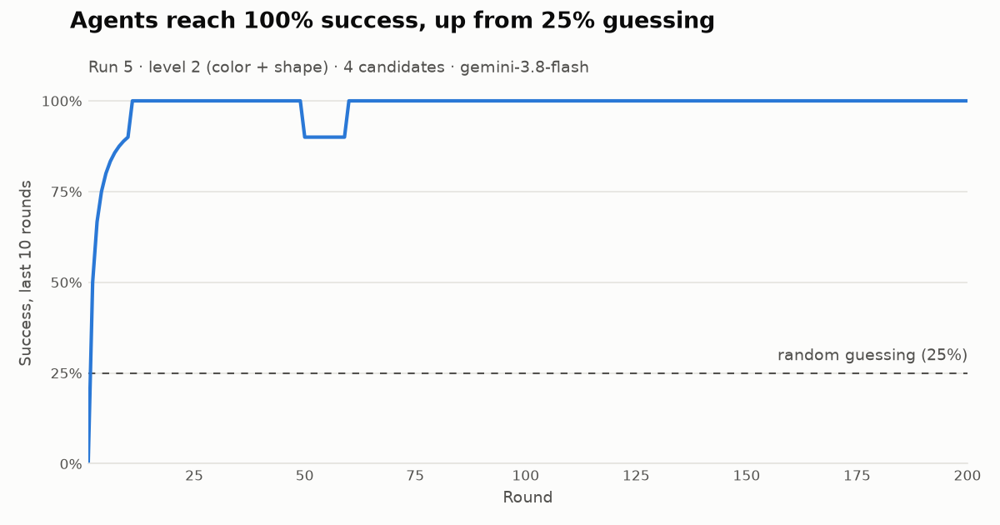

# 👽 Alien First Contact

**Two LLM agents that share no language invent one from scratch, and it has grammar.**

Two Gemini agents play a guessing game using only randomly generated alien symbols like `⟁ ⧖ ⍨ ⏇`. No symbol means anything at the start. They never share memory. Within about 20 rounds they agree on a vocabulary. When symbols are scarce, they build **compositional grammar** on their own: a color word plus a shape word, word order, and even new words made by doubling old ones.

> As AI agents built by different companies start working together, how do they learn to understand each other? This project is a small, controlled experiment in **emergent communication**: watching that understanding form from nothing.



## Key results

| Finding | Evidence |
| --- | --- |
| A shared language emerges every time | 9/9 standard runs beat the 25% random baseline by round 20; most reach 98–100% |
| Scarce symbols produce grammar | Topographic similarity 0.68–0.78 in every Level 2–3 run (shuffled messages: 0.00, p = 0.001) |
| Agents settle for "good enough" languages | 1 of 4 Level 2 runs used shape words only (79%); Level 3 encoded direction but never distance (80%) |
| Private notes halve the cost | Same structure, $0.67–0.88 per run instead of $1.53 |
| Telling the speaker what was picked helps | Level 3 rose from 80% to 90–93% with full feedback (2 runs, cut short at 80–97 rounds) |
| They describe objects they have never seen | 4 of 5 held-out objects understood on first sight; e.g. *purple star* = purple word + star word |
| Newcomer test hit a ceiling | A fresh listener reached 95% in 20 rounds, but so did the original pair, so no difference was measurable |
| Two tribes meeting | <!-- RESULT: tribes --> pending |

Total cost of every experiment in this README: **<!-- RESULT: total cost --> pending**.

## The language they invented (Level 2, run 5)

30 objects (6 colors × 5 shapes), but only 8 symbols and at most 3 per message. Nobody told the agents any of this:

| Word | Meaning | | Word | Meaning |
| --- | --- | --- | --- | --- |
| ⍨ | red | | ⏇ | circle |
| ⌹ | blue | | ⏇ ⏇ | square (circle, doubled) |
| ⍟ | green | | ⧖ | triangle |
| ⍡ | orange | | ⧖ ⧖ | diamond (triangle, doubled) |
| ⌸ | yellow | | ⏧ | star |
| ⍨ ⌹ | purple (red + blue) | | | |

So **green star** = `⍟ ⏧`, **blue diamond** = `⌹ ⧖ ⧖`, **purple star** = `⍨ ⌹ ⏧`.

When the 3-symbol limit made "purple diamond" impossible to say (`⍨ ⌹ ⧖ ⧖` is 4 symbols), the validator rejected it, and the agents adapted by accepting a small ambiguity, much like natural languages do.

At **Level 3** (navigating a 7 × 7 grid) they invented four direction words with a fixed word order: `⟁` up, `⩛` down, `⍾` left, `⍟` right. "2 right, 3 up" became `⟁ ⍟`. They never invented numbers.

## How it works

```
        target: "red circle"                      candidates: 1. blue star
              │                                               2. red circle
              ▼                                               3. red square
       ┌─────────────┐     message: ⍨ ⏇     ┌─────────────┐   4. green circle
       │   SPEAKER   │ ───────────────────▶ │  LISTENER   │ ──▶ picks 2 ✅
       │ own notebook│   (validator checks: │ own notebook│
       └─────────────┘    alphabet, ≤ 3)    └─────────────┘
              ▲                                    │
              └────── both learn the outcome ──────┘
```

1. The **speaker** sees a target and sends 1–3 symbols from this run's random alphabet.
2. A **validator** rejects anything else (English words, letters, too many symbols), and the round fails.
3. The **listener** sees 4 candidates and picks one.
4. Both record the round in a **private notebook**. Every 20 rounds each agent rewrites its own notes to keep prompts short.

### Rules that keep the experiment valid

- No human language in messages; the validator is the single source of truth.
- A new random alphabet every run, drawn from 40 abstract glyphs with no letters, digits, or shape-like symbols.
- Agents never share memory. The only channel between them is the message.
- Prompts never say what any symbol means or hint at a scheme (see `SPEAKER_SYSTEM` / `LISTENER_SYSTEM` in `agents.py`).
- Every round is logged with both agents' reasoning, so every claim here can be traced to raw data.

## Experiments

| Experiment | Question | Command |
| --- | --- | --- |
| Level 1: colors | Does any shared code emerge? | `python main.py --level 1 --rounds 100` |
| Level 2: color + shape | Does grammar emerge when symbols are scarce? | `python main.py --level 2 --rounds 200` |
| Level 3: grid | Can they invent directions and numbers? | `python main.py --level 3 --rounds 200` |
| Full feedback | Does knowing *what* was picked fix lazy languages? | `--feedback full` |
| Held-out test | Can they describe objects never seen in training? | `--experiment holdout` |
| Newcomer | Does a fresh agent learn faster from a speaker who already has a language? | `--experiment newcomer` |
| Two tribes | When two independently grown dialects meet, what happens? | `--experiment tribes` |

<!-- RESULT: experiment details -->

## Measuring structure: topographic similarity

In a compositional language, similar meanings get similar messages. For every pair of meanings we compute the **meaning distance** (attributes that differ, or grid steps apart) and the **message distance** (symbol edits, i.e. Levenshtein distance), then take their Spearman correlation. To rule out chance, the same messages are randomly reassigned to meanings 1,000 times (a permutation test). Real languages here score about 0.7; shuffled ones score 0.00.

## Honest limitations

- **Prior knowledge leaks in.** Symbols are invented, but ideas like "purple = red + blue", or picking `⧖` for triangle because it looks like one, come from the model's training on human text.
- **One model family.** All agents are `gemini-3.8-flash`; results may differ across models.
- **Small samples.** Most conditions have 1–4 runs. Each conclusion above says how many.
- **Notebooks contain words.** Targets are shown as English names (or grid pictures), and each agent's notebook records them that way. Only the *messages* are restricted to alien symbols.

## Dashboard

```bash
streamlit run app.py
```

Browse every run: success curve, emerged dictionary with its compositionality score, a round-by-round replay showing exactly what each agent saw and its reasoning, and each agent's private notes over time. It opens the database read-only, so it is safe while experiments run.

## Run it yourself

```bash
python -m venv .venv && .venv\Scripts\activate     # Windows (source .venv/bin/activate elsewhere)
pip install -r requirements.txt
cp .env.example .env                               # add your Gemini API key
python main.py --mock --rounds 20                  # free: random agents, no API calls
python main.py --level 2 --rounds 200              # real run (~$0.80)
python analyze.py                                  # chart, dictionary, compositionality
python -m unittest discover -s tests -t .          # 38 tests
```

## Project structure

| File | Purpose |
| --- | --- |
| `world.py` | Objects, grid cells, random alphabet, the message validator |
| `agents.py` | Speaker and listener with private notebooks and notes; Gemini and mock "brains" |
| `main.py` | Experiments as phases, the game loop, SQLite logging |
| `metrics.py` | Edit distance, topographic similarity, permutation test |
| `analyze.py` | Charts, emerged dictionaries, per-experiment reports |
| `costs.py` | Official Gemini prices and per-run cost estimates |
| `app.py` | Streamlit dashboard |
| `tests/` | 38 unit tests, including privacy and rule-enforcement checks |

## Built with

Python 3.12 · Google Gemini API with structured outputs (Pydantic) · SQLite · matplotlib · SciPy · Streamlit
